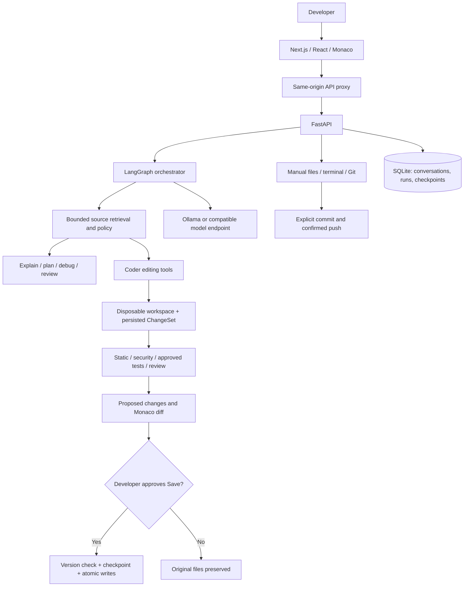

# Forge — Multi-Agent AI Coding Assistant

Forge is a local coding workspace combining a Monaco editor, integrated terminal, Git tools, and a selective multi-agent engineering workflow. Ask it to understand a repository, propose source edits, run approved checks, and explain the evidence behind a change.

**Agent edits are staged for review.** Saving approved files, committing, and pushing are separate actions. Forge is intended for a trusted, single-user machine; it is not a hosted, multi-tenant execution sandbox.

## Key features

- Everyday development: scratch files, tabs, syntax highlighting, Ctrl+S, Save As, draft recovery, search, formatting, file/folder operations, and a real terminal.
- Source-aware explanations, architecture analysis, planning, debugging, code review, test generation, and security inspection.
- Real staged create/write/patch/move/rename/delete/directory tools, metadata and existence checks.
- Selected-code editing with file versions, Unicode-aware ranges, and protection for surrounding source.
- Side-by-side Monaco diffs, all-file or individual-file approval, rejection, source-hash conflict checks, and agent change history.
- Python AST/Ruff, JSON/TOML parsing, JS/TS Tree-sitter syntax, source security checks, Bandit, approved pytest, and independent model review.
- Persisted task checkpoints, bounded budgets, provider cooldowns, and explicit continuation from the saved stage.
- HTTPS clone, Git status/diffs, staging, commits, branches, fetch, fast-forward pull, confirmed push, and conflict inspection.
- Offline evidence mode, Ollama, and an OpenAI-compatible Chat Completions adapter, including OpenRouter.

## Multi-agent architecture

The deterministic orchestrator selects relevant work instead of running every agent for every request. Read-only roles inspect source; the coder edits a staged copy; security, testing and review evaluate the proposal.

| Component | Responsibility |
| --- | --- |
| Orchestrator | Classify intent and enforce read-only/modification workflows |
| Repository/context retrieval | Rank paths, read bounded source, attach provenance |
| Planner | Prepare implementation steps or a read-only plan |
| Coder | Submit executable editing actions in a working snapshot |
| Debugger / analyzer / explainer | Investigate symptoms, relationships, or source behavior |
| Security reviewer | Source checks, Bandit, separate model assessment |
| Tester | Discover and execute supported tests after permission |
| Independent reviewer | Review actual source, diffs and validation evidence |
| Application service | Check versions, record a checkpoint, save approved changes |

Delegation is bounded and role-scoped. Model output alone never proves that a file changed or a test passed. See [architecture](docs/architecture.md) and [agent responsibilities](docs/AGENTS.md).

## System architecture



## Technology stack

| Layer | Actual implementation |
| --- | --- |
| Backend | Python 3.11+, FastAPI, Uvicorn, Pydantic, SQLAlchemy |
| Agent workflow | LangGraph, HTTPX adapters, schema-validated tool calls |
| Frontend | Next.js 16, React 19, TypeScript, Tailwind CSS 4 and custom CSS |
| Editor / terminal | Monaco, xterm.js, pywinpty on Windows / POSIX PTYs |
| Code intelligence | Python AST, JS/TS Tree-sitter, bounded source retrieval |
| Checks | pytest, Ruff, mypy, Bandit; frontend TypeScript/build/render checks |
| Persistence | SQLite by default; optional PostgreSQL driver support |
| Dependencies | Python pyproject + pinned locks; npm package-lock.json |

No Docker or mandatory vector database is required. Embedding/vector-store interfaces are extension contracts, not an installed retrieval service.

## Project structure

```text
.
├── backend/
│   ├── app/                    # API, agents, graph, tools, services, security
│   ├── tests/                  # Integration and regression tests
│   ├── scripts/                # Optional live-provider acceptance runner
│   ├── pyproject.toml
│   ├── requirements.lock       # Pinned runtime dependencies
│   └── requirements-dev.lock   # Pinned runtime + development dependencies
├── frontend/                   # Next.js, Monaco, chat and workspace panels
│   ├── package.json
│   ├── package-lock.json
│   └── .env.example
├── scripts/serve-backend.mjs    # Local backend supervisor
├── docs/
├── .env.example                # Backend placeholders
├── requirements.txt            # Root installation entry point
└── start-forge.ps1              # Optional Windows background launcher
```

Local state, repositories, imported snapshots and execution artifacts live under `.data/` and are excluded from Git, along with credentials, dependencies and build output.

## Prerequisites

- Python **3.11+**; release checks use Python 3.12 on Windows.
- Node.js **20.9+** and npm; the existing npm lockfile is retained.
- Git on PATH for repository operations.
- Optional [uv](https://docs.astral.sh/uv/) for installing pinned Python dependencies.
- A compatible model for generation/review. Evidence mode needs no key; explicitly requested new empty files need no model.

## Installation

Run from your checkout and preserve any existing `.env`.

### Windows PowerShell

```powershell
python -m venv .venv
.venv/Scripts/python.exe -m pip install -r requirements.txt
# Optional development/test tools:
.venv/Scripts/python.exe -m pip install -r backend/requirements-dev.lock
if (-not (Test-Path .env)) { Copy-Item .env.example .env }
Set-Location frontend
npm ci
Set-Location ..
```

### macOS / Linux

```bash
python3 -m venv .venv
.venv/bin/python -m pip install -r requirements.txt
.venv/bin/python -m pip install -r backend/requirements-dev.lock
[ -f .env ] || cp .env.example .env
cd frontend
npm ci
cd ..
```

Alternatively, use `uv venv .venv` and `uv pip install --python .venv/Scripts/python.exe -r requirements.txt`, then the development lock if needed. Use `.venv/bin/python` on POSIX.

pytest, Ruff and Bandit are runtime dependencies because Forge invokes them for staged validation. The development lock additionally includes mypy and pytest-asyncio. See [installation details](docs/INSTALLATION.md).

## Environment configuration

Edit the **root** `.env` for backend settings. Start with [.env.example](.env.example); all supported settings are documented in the [configuration reference](docs/configuration.md).

```dotenv
# JSON array of permitted project roots; "." means this checkout.
WORKSPACE_ROOTS=["."]
DATABASE_URL=sqlite:///.data/forge.db
LLM_PROVIDER=evidence
LLM_MODEL=
LLM_API_KEY=
LLM_BASE_URL=http://127.0.0.1:11434
```

OpenRouter uses the compatible adapter:

```dotenv
LLM_PROVIDER=openai_compatible
LLM_BASE_URL=https://openrouter.ai/api/v1
LLM_MODEL=your-available-tool-capable-model
LLM_API_KEY=replace-locally
LLM_TOOLS_ENABLED=true
```

The credential variable is `LLM_API_KEY`. Forge does **not** read separate `OPENAI_API_KEY`, `ANTHROPIC_API_KEY` or `GEMINI_API_KEY` settings. Keep credentials out of frontend code and Git history. Model-role mappings and fallback lists use JSON; automatic fallback defaults to off.

Optional `frontend/.env.local` can set `FORGE_BACKEND_URL` (default `http://127.0.0.1:8000`). Next.js reads its own environment file; the backend `.env` does not configure it. `FORGE_SMOKE_URL` overrides the smoke runner's app URL. Neither setting should contain a provider credential.

Restart the relevant service after settings changes. Remote providers receive bounded, redacted source/context; redaction is not comprehensive data-loss prevention.

## Running the backend

From the repository root:

```powershell
.venv/Scripts/python.exe -m uvicorn app.main:app --app-dir backend --host 127.0.0.1 --port 8000
```

On POSIX use `.venv/bin/python`. [Health](http://127.0.0.1:8000/health) · [API documentation](http://127.0.0.1:8000/docs).

## Running the frontend

In a second terminal:

```text
cd frontend
npm run dev
```

Open [Forge at 127.0.0.1:3000](http://127.0.0.1:3000/). For a production frontend build, run `npm run build` followed by `npm start`.

On Windows, after building, `./start-forge.ps1` launches hidden background services and reuses healthy ones. A Node supervisor restarts unexpected backend exits with bounded backoff. Logs/process records remain in `.data/`; model tasks do not resume automatically.

**Deployment boundary:** these commands run Forge locally. Host/origin checks restrict the app to loopback. There is no public hosting, authentication or tenant-isolation layer. Publishing source to GitHub does not deploy a public service; do not expose these services to the Internet.

## Supported LLM providers

| Configuration | Behavior |
| --- | --- |
| `evidence` | Offline source/index facts; no simulated generation or model review |
| `ollama` | Local Ollama chat adapter; use a tool-capable model |
| `openai_compatible` | Chat Completions endpoint, including OpenRouter; native tools or structured JSON |

`LLM_ROLE_MODELS` selects models by role. `LLM_JSON_MODE` is opt-in for compatible JSON-mode endpoints. Rate limits preserve checkpoints and Retry-After metadata; continuation is explicit. There are no native Anthropic or Gemini adapters. Compatibility does not guarantee a model's quality or availability. Live Ollama and PostgreSQL remain unverified in the recorded Windows checks.

## How to use Forge

1. Create a project, open a local path under WORKSPACE_ROOTS, or clone HTTPS source.
2. Edit normally: new files, Ctrl+S, Save As, tabs and search are independent of the model.
3. Choose **Auto**, **Ask**, or **Plan**. Attach files or select code for context.
4. Review progress/evidence and approve local test execution when appropriate.
5. Inspect proposed diffs, then save approved files or discard the proposal.
6. Stage and commit separately; review and confirm each push destination.

Browser folder pickers import a filtered **copy**, leaving the selected original untouched. Entering a backend-accessible path opens the actual directory. The UI identifies imported snapshots. Managed projects default to `.data/`.

## Agent workflows

- **Explain / Ask:** inspect and answer without editing/executing project code.
- **Plan:** inspect and propose steps; implementation needs an explicit follow-up.
- **Modify:** context → plan → staged editing → static/security checks → approved tests → independent review → proposal.
- **Selected edit:** verify version/text, target the selected range, preserve surrounding source, show the diff.
- **Pause/resume:** preserve plan, files and next stage; continue after cooldown or permission approval.

Empty-file requests and exact supplied code use deterministic staging rather than code generation. Prose without an edit triggers one schema-validated recovery attempt. Invalid recovery is an incomplete task, not a successful change.

## Code editing and review

Original disk content, proposed changes, saved files, Git index entries, local commits and remote commits are distinct states. Save All / per-file Save write actual files only after required gates and version checks. Individual rejection revalidates the remaining subset.

History records hashes, diffs, reasons, validation, task/conversation IDs and checkpoints. Restore refuses to overwrite later manual saves. Unsaved Monaco buffers survive source refreshes; later manual saves can surface a conflict.

New empty files/directories use structural checks and report tests as not applicable. Literal-print-only Python files have a narrow structural fast path. Other changes retain normal gates. See [editing and Git behavior](docs/editing-and-git-upgrade.md).

## Testing and security

From `backend/`, using the repository venv:

```powershell
../.venv/Scripts/python.exe -m pytest -q
../.venv/Scripts/python.exe -m ruff check app tests
../.venv/Scripts/python.exe -m mypy app
../.venv/Scripts/python.exe -m bandit -r app -q
```

From `frontend/`:

```text
npm run typecheck
npm run test:unit
npm run build
npm audit
npm run smoke
```

Smoke checks need both services. No ESLint script/configuration exists; TypeScript/build checks are not an ESLint run. [Verification records](docs/verification.md) separate suites, follow-up checks, controlled provider faults and live operations.

Commands use guarded argv, bounded time/output, limited environments and process-tree cleanup. Approved project tests/hooks can execute local code: **a disposable workspace is not an OS sandbox**. Manual PTYs are real shells. Findings/model opinions are scoped evidence, not certification. See [SECURITY.md](SECURITY.md).

## Git / GitHub integration

Forge uses real Git CLI operations: HTTPS clone, status/diffs, stage/unstage, commit suggestions, branches, history, fetch, fast-forward pull and confirmed push. Private HTTPS repositories use system/global credential helpers. Authenticate outside Forge with a credential manager or GitHub CLI; never paste passwords/tokens into chat.

Push confirmation identifies URL, branch and commit; the backend rechecks them, never force-pushes, and verifies the remote commit before claiming success. Dirty worktrees block pull/switch operations that could replace work. Conflicts expose base/current/incoming content; developers edit and stage a reviewed resolution.

PR descriptions cover current working changes. **Forge does not create pull requests** or claim to summarize committed branch history. SSH remotes and hunk-level staging are not implemented. Tests use owned temporary remotes; public GitHub clone was verified. Authenticated GitHub push remains a separate user-approved action.

## Current implementation status

| Area | Status |
| --- | --- |
| Manual editor/files/terminal and staged agent edits | Implemented |
| Source-aware agents, LangGraph routing, native editing tools | Implemented |
| Hash-based approval/checkpoints and task pause/resume | Implemented |
| Python test gates; JS/TS syntax checks | Implemented with explicit scope |
| HTTPS Git workflows and conflict inspection | Implemented; remote access depends on credentials |
| PR description generation | Implemented; no PR creation |
| Browser end-to-end verification | Extension contract only |
| Embedding/vector stores | Interfaces only; not required |
| Public deployment, authentication, tenancy | Not implemented |

## Known limitations

- Trusted single-user local application; no OS isolation or multi-user authentication.
- Automatic executable validation supports Python pytest. Manual commands support other tools; syntax checks are not runtime tests.
- Models can return incomplete/invalid output or throttle. Unexecuted tests, unavailable reviews and unapplied edits are never represented as successful.
- Full nested gitignore semantics, cross-language resolved call graphs and PostgreSQL migrations are incomplete.
- Live PostgreSQL/Ollama and POSIX PTYs require more verification.
- UI render/build checks do not replace interactive browser tests; desktop automation could not complete the recorded browser verification.

## Future roadmap

Planned work includes a permission-aware browser verifier, more test adapters, stronger execution isolation, migration tooling, richer conflict workflows, explicit PR creation, and optional semantic retrieval. These are not current capabilities or delivery promises.

## Contributing

Read [CONTRIBUTING.md](CONTRIBUTING.md), preserve approval/version-check boundaries, and include real verification evidence. Do not submit credentials, local state, generated dependencies or private project snapshots. See [CHANGELOG.md](CHANGELOG.md).

## License

No license has been selected and no LICENSE file is included. Repository visibility does not itself grant a software license. Dependency and bundled-asset notices remain those of their respective authors.
