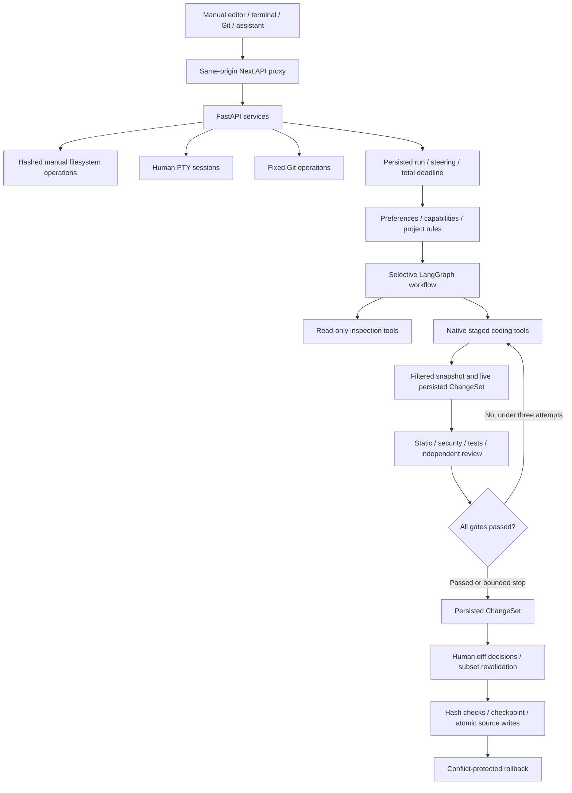

# Forge IDE architecture · 0.3

The upgrade preserves the existing FastAPI/SQLAlchemy/LangGraph/Next.js/Monaco foundation. Two loopback services share a single-user local state directory.

## Ownership and source

`create_app` owns database sessions, HTTP client, terminals and services. Each run owns its graph, `EngineeringSession`, tool registry, context and `RunControl`. Native messages and tool results are per-loop; there is no shared model conversation between concurrent tasks. LangGraph recursion, model rounds, tool calls, source context, command duration/output, repair attempts, steering updates and total task time are bounded. Startup pauses checkpointed interrupted runs for explicit continuation; checkpointless interrupted runs fail. Cancelled runs remain cancelled, without replaying edits.

`ProjectService` supports actual paths under `WORKSPACE_ROOTS`, browser-imported copies and new managed projects. Managed paths must be exact UUID children of their corresponding state container. Empty projects are valid. Browser pickers request read permission only; source copies are explicit in the UI. `WorkspaceFiles` provides manual read/write/create, directory creation, move, trash/restore and search. Writes use optimistic hashes and atomic replacement under a shared workspace lock.

The source policy rejects traversal, absolute/drive/stream/reserved paths, links/junctions, credential paths, binaries and oversized text. Agent reads honor root `.gitignore` and `.forgeignore`; manual ordinary source reads do not apply the agent ignore list. Python AST and JS/TS Tree-sitter build symbols; dependency retrieval combines exact paths, text, symbols and nearby relationships. Uniquely resolved imports are verified, while name-based call candidates remain inference. Root/nested AGENTS/FORGE rules and `.forge/rules/*.md` are bounded and redacted. Rules cannot grant capabilities.

## Native agents and provider boundary

`LLMProvider` supplies legacy `complete` and normalized native `respond`, with declared capabilities, canonical tool calls, usage, finish reason and optional role models. OpenRouter/Chat Completions and Ollama adapters normalize their different envelopes. Native calls are never recovered by executing JSON found inside arbitrary model prose. Protocol/reasoning artifacts and fake tool envelopes fail format validation. Source/history/tool text is untrusted; known credentials are redacted. HTTP clients do not inherit proxy credentials, follow redirects or return upstream bodies to users.

The deterministic router chooses explanation, architecture, debug, plan, review, security, test or modification. Read-only roles receive inspection/search/rules/Git tools. Coder additionally receives staged editing, guarded commands and a bounded isolated specialist-analysis tool. Subspecialists cannot recursively delegate, edit, execute or approve the parent change. Independent security/reviewer calls receive actual source, diff and validation evidence, with a schema-only report-submission tool. A malformed report fails closed. Evidence mode cannot impersonate coding/review.

`PermissionPolicy` merges global/project capability decisions. Deny overrides request approval; Ask can be satisfied for one task. Ask/Plan hard-disable mutation/execution even when the client asks to allow them. The configured LLM transport is distinct from development-command network permission. The human terminal and editor are separately authorized user actions.

## Staging, validation and application

Task and stage lifecycles are explicit. Native coders declare implementation completion; a model/tool limit or provider interruption leaves unfinished work PAUSED and final gates NOT_RUN. Resuming an unfinished attempt invalidates current final reports while retaining earlier validation history. Only completed implementation can enter final static/security/test/review methods. HTTP throttling carries per-model Retry-After metadata; explicit resume observes cooldown, with optional configured fallback disabled by default. The same task checkpoint restores model selection and survives backend restart. See [task lifecycle](task-lifecycle.md) for states, dependencies and acceptance evidence.

The staged runtime uses explicit UNDERSTAND, CONTEXT, PLAN, IMPLEMENT, VALIDATE, SECURITY, TEST, REVIEW and FINALIZE stages. Metadata ranks task-local source before reads. Empty/new-file tasks proceed to implementation without searching. Context has independent read/search/round budgets, cached resource results and a third-duplicate progression signal. A stalled initial implementation or repair submits a schema-defined concrete patch; an existing staged file alone cannot count as a new repair edit. Validation and testing are owned by the next graph stage. A narrow new literal-print Python module uses AST/security checks and optional actual script execution; its review is explicitly structural, not a model opinion.

`RunRuntime` shares counters and global last-resort limits across graph nodes, providers, tools, validators and bounded read-only delegates. Each actual mutation persists a working, non-applicable ChangeSet before returning the tool result. `RunCheckpoint` stores the request, plan, source evidence, inspection cache, staged baseline, reports, attempts and next stage. Explicit continuation acquires a lineage/ChangeSet lease, checks source and staged hashes, honors fresh permissions and starts at that stage. Reviewer outages resume at REVIEW; test approval resumes at TEST. No background worker automatically continues a run. API/UI expose diagnostics and safe checkpoint summaries; internal checkpoint content is not returned as diagnostics.

A registry lazily copies bounded indexed source into a managed snapshot. Existing whole-file rewrites/deletes require full inspection; patches must match a unique inspected block. Unsaved saved-file buffers require matching disk hashes and seed the staged view. New files, file moves/deletes and real empty directories become typed proposals. Original source remains unchanged. Repairs seed the previous proposal rather than starting from a blank snapshot and receive actual failing output. Provider failure during a later repair can preserve the prior blocked proposal.

`stage_proposal` independently rechecks paths, ignore policy and source evidence. Static validation uses Python AST/Ruff, JSON/TOML parsing and JS/TS Tree-sitter. Other text is not claimed syntax-verified. Security combines source checks, Python Bandit and a separate model opinion. Pytest runs with explicit execution permission; hashes before/after reject test mutation of reviewed source. Reports distinguish actual observations from model opinions and pending verification.

`ChangeService` requires static/security/test/independent-review gates and checks the full indexed baseline. High-risk edits need an additional human approval. Per-file rejection rebuilds and revalidates the remaining subset; reports for a different combination cannot certify it. Application is serialized with workspace/database locks and creates checkpoints before writes. Each file is atomically replaced, deleted or created; write failure rolls back the attempted application. Checkpoint restoration verifies all after-images before any writes, protects later edits, and only removes newly created directories when empty.

## Execution, Git and hooks

Agent `CommandRunner` accepts argv under `CommandGuard`, with explicit package/network permission, limited environment, bounded output/time and cancellation cleanup. Fixed validation commands use `ValidationRunner`. Windows Job Objects and POSIX groups terminate process trees. Project execution is not OS filesystem/network isolation.

Human terminals are separate pywinpty/cmd.exe or POSIX PTYs with input, output, resize, history, stop and shutdown cleanup. They are never exposed as an agent stdin tool. Git uses fixed commands with disabled hooks, fsmonitor and external diff/textconv. Network operations reset repository helpers and use trusted system/global credential helpers with HTTPS-only transport, TLS verification and no interactive prompt. Human controls provide init, stage/unstage, commit, branch creation/switching, clone, fetch, fast-forward pull and explicitly confirmed push. Push rechecks URL/branch/commit and verifies the remote result. Model review receives path-filtered changes; commit/PR drafts use filtered evidence. PR creation is not implemented.

`HookService` loads typed `.forge/hooks.json` events. Configuration never grants permission. File-save/task-completion hooks queue explicit approval; task tool hooks use the task policy and snapshot; commit hooks require human approval. Runs persist actual argv, workspace, output, exit code and evidence. Failed before hooks block their associated operation.

## Frontend state

Project, editor, conversation and layout hooks are separate. Scratch buffers do not require a project. Bounded unsaved source drafts are stored locally for recovery, alongside IDs, paths and layout settings; credentials are excluded. In-memory buffers are scoped by project and survive switching. Async project-sensitive operations reject stale callbacks. Manual Save preserves text typed while a write is in flight. Applying/restoring source preserves unsaved buffers, whose next save can surface a hash conflict.

SSE carries structured progress/artifacts, not private reasoning. The composer supports safe-boundary steering and Stop. Plans have edit/implement/cancel controls. Commands, tests, Problems, Git, search, checkpoints and hooks live in a resizable bottom dock. Monaco supplies editing/diff/search and syntax features, with local workers/assets. The command palette and keyboard shortcuts invoke the same concrete actions as visible controls.

## Incomplete extensions

`ApplicationVerifier`/`VerificationEvidence` define a future browser-observation seam; no browser adapter or automated UI-success claim is implemented. Advanced specs, automatic background queues, automatic JS/TS executable validation, dependency auditing, full nested gitignore semantics, cross-language resolution, migrations, authentication/tenancy and OS sandboxing remain future work. PostgreSQL/Ollama and POSIX PTYs were not exercised live on this Windows host. No Docker, mandatory Qdrant or desktop wrapper was added.
